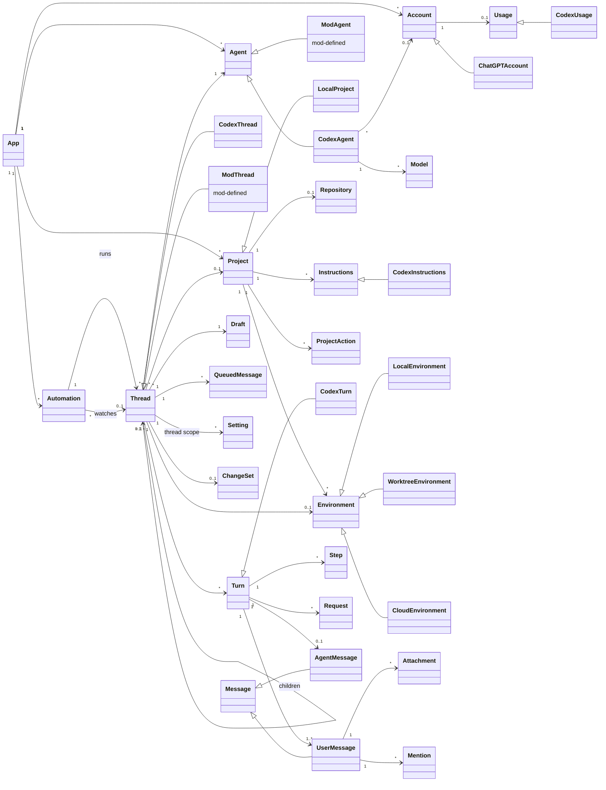
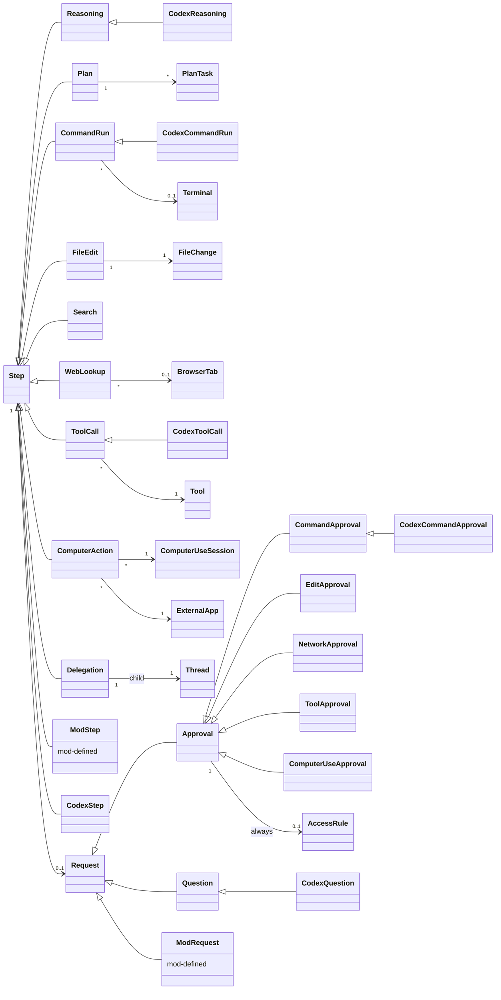
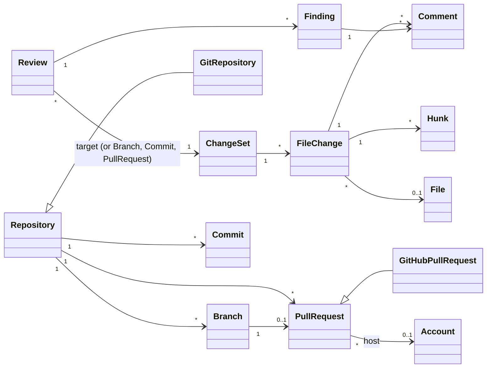
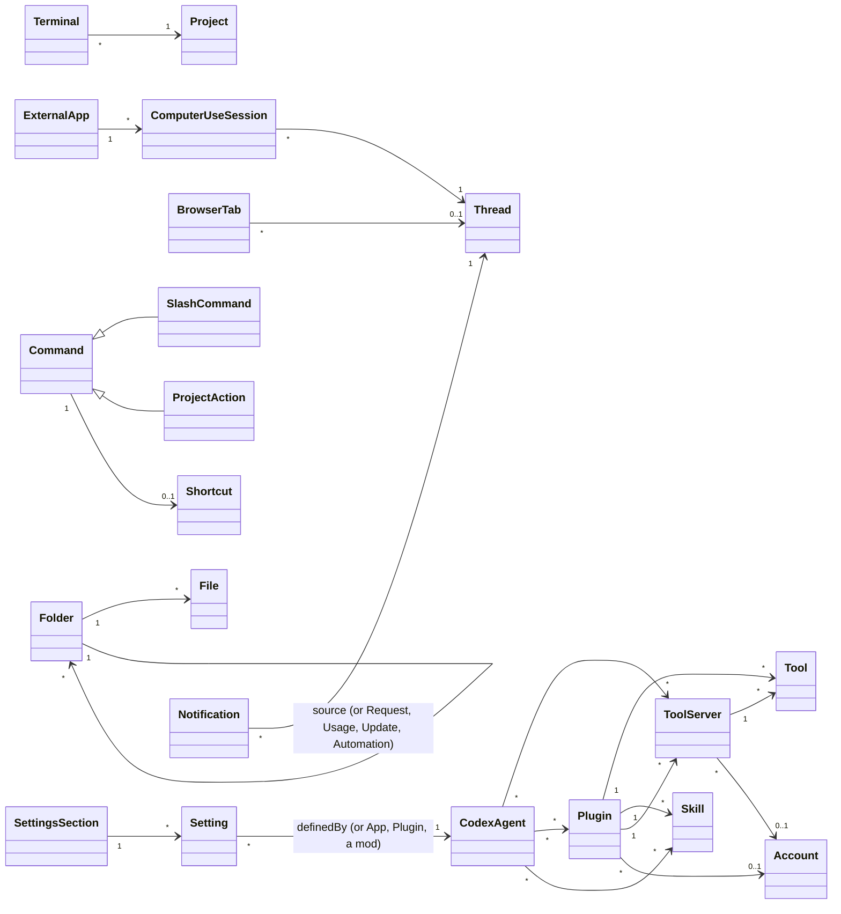

# 05 Overview graph

For review only: the cards in 02 and 03 are the source of truth. `<|--` means "is a subtype of", and other arrows are relations with
cardinality. `Mod…` boxes stand for subtypes a mod defines.

## Agents, threads and the conversation

## Agent activity and requests

## Changes, review and version control

## Tools, extensions, commands and settings

## Presentations and what they present

Containment in a window is in 03 ("The tree"). Here, each presentation points at the concepts it presents.

```mermaid
flowchart LR
  Any[any type]
  Window & Sidebar & Palette & DockBadge --> App
  SidebarSection --> Project & Automation
  SidebarItem --> Thread & Automation
  Menu --> Any
  MenuEntry --> Command & ExternalApp
  PaletteResult & Chip & Dialog & DetailView & PanelTab --> Any
  ThreadView & ThreadHeader & SidePanel --> Thread
  TurnView --> Turn
  MessageBlock --> Message
  ContentView --> Content
  StepBlock --> Step
  RequestCard --> Request
  Composer & NewThreadView --> Draft
  ComposerPicker --> Agent & Model & Environment & Branch & Setting
  QueueItem --> QueuedMessage
  AutomationView --> Automation
  ChangesView --> ChangeSet & Repository & PullRequest
  DiffView --> FileChange & Hunk & Comment
  ReviewView --> Review & Finding
  TerminalView --> Terminal
  BrowserView --> BrowserTab
  FilesView --> Folder & File
  FilePreview --> File
  SettingsPage --> SettingsSection
  SettingsRow --> Setting & Account & ToolServer & Plugin & Skill & AccessRule
  NotificationBanner --> Notification
  StatusItem --> Usage & Thread
```

